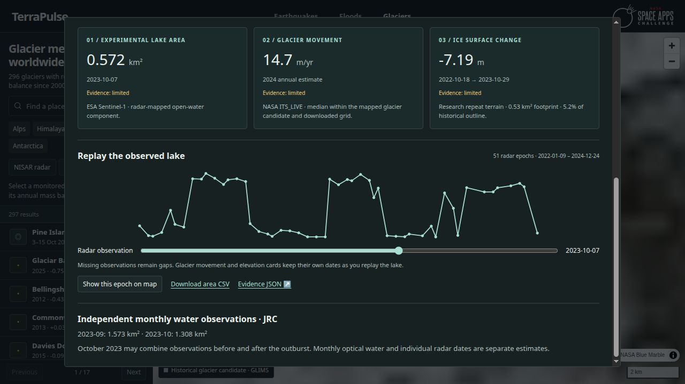

# GLOF monitoring integration

Open **Monitor GLOFs** in the map toolbar, or visit
`/?glof=south_lhonak`. The normal view combines experimental lake area,
annual glacier-candidate movement and dated partial ice surface change.
The expert view exposes reference checks, coverage, source provenance,
indicator maps, CSV/JSON and the partial surface-change GeoTIFF.

## Published run

| Site | Radar epochs, 2022–2024 | Annual glacier movement, 2024 | Repeat terrain |
| --- | ---: | ---: | --- |
| South Lhonak | 51 | 14.71 m/year | Partial 2022-10-18–2023-10-29 |
| Imja Tsho | 50 | 3.37 m/year | Unavailable |
| Tsho Rolpa | 50 | 2.21 m/year | Unavailable |
| Palcacocha | 50 | Unavailable | Unavailable |
| Suicide Basin | 52 | 20.04 m/year | Unavailable |

The South Lhonak walkthrough initially selects 7 October 2023, after the
documented 4 October outburst. Earlier/later acquisitions are selectable.
Changing the epoch updates the lake-area card and the geometry sent to the
main map. Annual glacier movement and repeat terrain retain their own dates.
Unresolved lake estimates remain null/gaps, including 47 Suicide Basin epochs.

South Lhonak's partial surface-volume estimate is −3.801 million m³ over
0.529 km², only 5.2% of the historical glacier candidate. It is not total
glacier volume, glacier mass change or lake water volume. Stable-ground NMAD
is 0.59 m, a scatter diagnostic rather than a calibrated volume error bar.
The spatial glacier association is provisional, with historical outline dates
preserved in the evidence.

Water-map grades and combined indicator grades are separate. A combined
“limited” grade does not upgrade an individual lake's “low” or “unassessed”
water-map evidence. None are calibrated event probabilities.

## Accuracy and limits

The shipped Sentinel-1 water model scores pooled IoU 0.5863 and F1 0.7392
over 446 Sen1Floods11 chips in 11 held-out event-region folds. The strongest
tuned terrain baseline scores IoU 0.4561. These are general surface-water
segmentation results, not GLOF prediction results or a fresh blind certification.

South Lhonak's final connected lake mask scores IoU 0.4923 on 25 September
and 0.6438 on 7 October 2023 against automatic optical references on nearby
dates. Expert tables distinguish final lake-mask checks from raw classifier
pixel diagnostics. Manual shoreline validation is pending; snow, ice, cloud,
registration and date differences limit quantitative interpretation. Threshold
sensitivity ranges are not confidence intervals.

The 2023 JRC monthly values remain independent context. October can mix
pre/post-outburst observations. The 1984–2024 occurrence product is not used
as a causal pre-2023 forecast input. Neither source supplies measured lake level.

Water level, lake water volume, dam stability, breach probability and validated
downstream inundation are unavailable. The integration does not serve the earlier
failed routing experiment or create warning tiers, arrival times or safety claims.

## Sources remain separate

- ESA/Copernicus Sentinel-1: modelled lake-area sequences; Sentinel-2: automatic
  optical references. RTC crops retain source granules and model hashes.
- NASA MEaSUREs ITS_LIVE: annual glacier movement and source quality.
- Joint NASA–ISRO NISAR, accessed through NASA/ASF: separate L-band context.
  The C-band water classifier is not applied to NISAR HH.
- India/NRSC: Resourcesat-2 South Lhonak inventory dated 2016. It is historical
  context, not same-date shoreline truth. ISRO S-band remains not ingested.
- GLIMS/NSIDC contributors: historical glacier outlines.
- EC JRC/Google: historical water occurrence and monthly water classifications.
- Research/CNES-derived Pléiades: repeat terrain for partial surface change.

Each summary retains acquisition manifests, source URLs, dates and limitations.
The release manifest hashes the packaged outputs and actual model weights.
Original scientific inputs and source provenance remain in the separate analysis
workspace. The Git release is approximately 11 MB of compact evidence/model
assets plus a real Sentinel-1 inference example; it excludes the full SAR archive.

## API and hosting

```text
GET /api/glof
GET /api/glof?site=south_lhonak
GET /api/glof?site=south_lhonak&view=geometry&date=2023-10-07
GET /api/glof?site=south_lhonak&view=csv
GET /api/glof?view=validation
```

Unknown lakes/dates return 404; unsupported views return 400; absent/corrupt
release files return 503. No interpolation or synthetic fallback is returned.
Geometry combines the selected SAR date with separately dated historical
inventory/glacier layers. Missing geometry is rejected during export.

The Python function reads the published release using only the standard library.
It works with Vercel's existing Python-function architecture. `vercel.json`
includes `server_data/glof/**`; public indicator imagery and the terrain
GeoTIFF are Vite static assets. It has no dependency on the old port-8081 service.
It does not run scientific processing or acquisition during a page request.

Run with the repository's existing commands:

```sh
npm ci
python -m pip install -r requirements.txt
python api/landslide.py
# second terminal
npm run dev
```

If port 8765 is occupied, use `TERRAPULSE_API_PORT=8766` for Python and
`TERRAPULSE_API_URL=http://127.0.0.1:8766` for Vite. Default ports are preserved.

## Reprocess and publish new observations

See [`machine learning/glof/README.md`](../machine%20learning/glof/README.md)
for dependencies and the actual CPU-inference reproduction. Fresh inference on
the shipped 7 October 2023 scene reproduces the published **0.5724 km²** area.

After scientific inference and indicator aggregation finish:

```sh
python scripts/export_glof.py --artifacts /path/to/real_mvp/artifacts
```

Review the release manifest and source dates before committing the release.
Acquisition/refresh is an offline job; no automatic polling is enabled here.

## Validation

API/release tests cover source hashes, actual HTTP JSON/CSV/errors, matching
model weights, dated geometry, missing glacier measurements, unresolved CSV
cells and the partial-volume contract. Frontend tests cover missing-value gaps,
elapsed-time positioning, the initial event epoch and antimeridian clipping.
Existing scar/ONNX and GUNW tests remain part of CI; a fresh real-data GLOF
inference check is added alongside the production frontend build.

Local integration verification on 15 November 2026: 18 API/scar tests,
7 existing scientific-pipeline tests and 5 frontend tests passed. Fresh
South Lhonak CPU inference reproduced 0.5724 km² exactly; the production
Vite build passed. Browser checks covered normal/expert modes, missing
Palcacocha measurements, loaded indicator maps, source/reference tables
and the selected-date overlay on TerraPulse's main map. The observed desktop
dialog had no horizontal overflow. These checks do not certify hazard accuracy.


